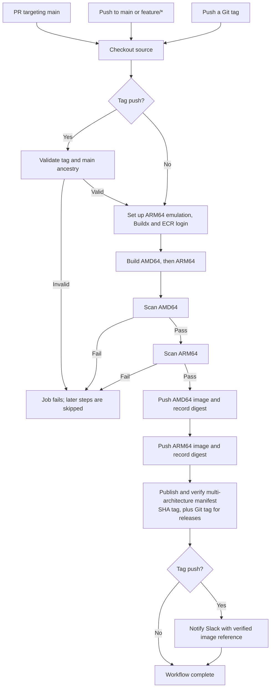

# hof-nginx

An Alpine-based reverse proxy using Alpine's native NGINX and NAXSI packages.
It does not use OpenResty, GeoIP or either of the retired proxy images. This
is a new, specification-first implementation, not a drop-in replacement for
the old proxy. Service migration and Home Office security and branding approval
are still required before production use.

The base is pinned to an Alpine 3.24 image digest for reproducibility. The
build upgrades Alpine packages and installs NGINX, NAXSI, OpenSSL, curl, CA
certificates and `envsubst`. It runs as UID 1000 and listens on unprivileged
ports 10080 (HTTP) and 10443 (HTTPS). The NGINX Alpine package supplies NAXSI's
core rules. Proxy-generated error pages cover 403, 404, 429, 500, 501, 502,
503 and 504. Application error responses pass through unchanged. Proxy-page
styling depends on the application's `/public` assets; Home Office branding
approval is still needed.

## Build and test

From this directory, with Docker running and GNU Make installed:

```sh
make help   # List local commands
make build  # Build hof-nginx:local
make test   # Build and run smoke tests
```

`make scan` builds and scans the image using a locally installed Trivy.
These commands do not push an image. Set `IMAGE=your-tag` on a make command
to use a different local image tag. The Docker build context is allowlisted in
`.dockerignore`; update it if the Dockerfile needs additional files.

The smoke test creates temporary containers, a Docker network and a volume,
then removes them. It checks non-root startup, HTTP and HTTPS proxying, TLS
upstream verification, error pages, NAXSI blocking and rule overrides, and
invalid configuration. Test each service's real configuration and traffic
separately before migration.

To run against an existing upstream reachable from Docker Desktop, replace
the host and port with your upstream and provide an absolute path to the
application's public assets:

```sh
make run PUBLIC_DIR=/absolute/path/to/app/public \
  PROXY_SERVICE_HOST=http://host.docker.internal PROXY_SERVICE_PORT=8080
```

This builds the image, binds ports 10080 and 10443 on localhost, and runs in
the foreground with HTTPS redirection disabled for local testing. If those
host ports are already in use, add `HTTP_PORT=18080 HTTPS_PORT=18443` to the
command and use those ports in the curl examples. Set `HTTPS_REDIRECT=TRUE`
to test redirects to the configured HTTPS host port instead.

In another terminal:

```sh
curl -i http://localhost:10080/ping
curl -i http://localhost:10080/
curl -ki https://localhost:10443/
```

`/ping` is a liveness check only; it does not check the upstream. The `/`
request requires a running upstream. Stop the container with Ctrl-C.

### View error pages with a Node.js test app

With Docker running, start the example app and proxy on a temporary network
(the `node:22-alpine` image is downloaded if needed). Set `PUBLIC_DIR` to an
absolute path containing the application's CSS and logo first:

```sh
export PUBLIC_DIR=/absolute/path/to/app/public
localhost_ip="$(docker run --rm --entrypoint getent hof-nginx:local ahostsv4 localhost | awk 'NR == 1 {print $1}')"
: "${localhost_ip:?Unable to resolve IPv4 localhost}"
docker network create hof-error-test
docker run -d --name hof-error-app --network hof-error-test \
  -v "$PWD/tests/error-pages-app.js:/app.js:ro" \
  node:22-alpine node /app.js
docker run -d --name hof-error-proxy --network hof-error-test \
  -p "$localhost_ip:10080:10080" \
  --mount "type=bind,src=$PUBLIC_DIR,dst=/public,readonly" \
  -e PROXY_SERVICE_HOST=hof-error-app -e PROXY_SERVICE_PORT=8080 \
  -e HTTPS_REDIRECT=FALSE hof-nginx:local
```

First run `make build` to build `hof-nginx:local`. Visit
`http://localhost:10080/` and follow the error links. Each should retain the
requested status code and show the app's plain-text response. Visit
`http://localhost:10080/nginx-proxy/429.shtml` to view a proxy error page.
The example app does not supply the `/public` assets itself. For example:

```sh
curl -i http://localhost:10080/status/404
```

If port 10080 is occupied, change the host side of the `-p` mapping and use
that port in the URL. When finished, remove the test containers and network:

```sh
docker rm -f hof-error-proxy hof-error-app
docker network rm hof-error-test
```

## Configuration

| Variable | Description |
| --- | --- |
| `PROXY_SERVICE_HOST` | Required upstream hostname or IP, optionally prefixed with `http://` or `https://`; no path or port. HTTP is the default. |
| `PROXY_SERVICE_PORT` | Required upstream port, 1–65535. |
| `HTTP_LISTEN_PORT`, `HTTPS_LISTEN_PORT` | Container ports; default 10080 and 10443. |
| `HTTPS_REDIRECT` | `TRUE` (default) redirects HTTP requests to HTTPS; `FALSE` allows HTTP proxying. `/ping` and error assets are not redirected. |
| `HTTPS_REDIRECT_PORT` | Optional external HTTPS port to include in redirects. |
| `SERVER_CERT`, `SERVER_KEY` | Certificate and private-key paths; default `/etc/keys/crt` and `/etc/keys/key`. |
| `NAME_RESOLVER` | DNS server IP, optionally with a port. Defaults to the first nameserver in `/etc/resolv.conf`. |
| `RATE_LIMIT_ENABLED` | `FALSE` (default) disables rate limiting; set to `TRUE` to enable it. |
| `REQS_PER_MIN_PER_IP` | Maximum proxied request rate per source IP when limiting is enabled; default 60 requests per minute. |
| `RATE_LIMIT_BURST` | Excess requests allowed above the configured rate when limiting is enabled; default 20. Excess requests are delayed, and requests beyond the burst receive HTTP 429. Set to `0` to reject requests as soon as the rate is exceeded. |
| `TRUSTED_PROXY_CIDRS` | Optional comma-separated list of trusted proxy IP addresses or CIDRs (IPv4 or IPv6). When set, resolve the client IP from `X-Forwarded-For` only for connections from these proxies. Empty by default. |
| `ACCESS_LOG_FORMAT` | `combined` (default), `extended_text`, or `extended_json`. Access logs go to stdout. |
| `LOG_REQUEST_BODY` | `FALSE` (default); set to `TRUE` to include request bodies in an extended access log. Requires `extended_text` or `extended_json`. |
| `GZIP_ENABLED` | `FALSE` (default); set to `TRUE` to enable gzip compression. |
| `VERBOSE_ERROR_PAGES` | `FALSE` (default); set to `TRUE` to display additional error-page details. |
| `FEEDBACK_EMAIL` | Optional simple email address shown on the non-verbose NAXSI denial page. |
| `NGINX_RELOAD_INTERVAL` | Time in seconds between periodic reloads performed by `/healthcheck.sh`; default 43200 (12 hours), minimum 300. |
| `EXTRA_NAXSI_RULES` | Additional NAXSI directives, applied to the proxy location. |
| `ADD_NGINX_SERVER_CFG` | Optional multiline NGINX directives inserted inside the server block. Supports server-level directives and locations; invalid configuration fails startup. |

NGINX starts only if its generated configuration passes `nginx -t`. Upstream
HTTPS verifies the server certificate and hostname using the system CA bundle,
and sends SNI. For a private CA, provide a complete trusted CA bundle at
`/etc/ssl/certs/ca-certificates.crt`. The proxy forwards the host without its
port and adds standard `X-Forwarded-*` headers.

By default, rate limiting uses the connection source IP (`$remote_addr`),
which may be an ingress pod shared by many users. To use client IPs behind
trusted proxies, set `TRUSTED_PROXY_CIDRS` to their actual source addresses
or networks as a comma-separated list. The proxy configures
NGINX to read `X-Forwarded-For` from trusted peers and select the last
non-trusted address in the chain. An untrusted peer's header is ignored; if
the header is absent or unusable, its connection address is used. This also
changes `$remote_addr` in access logs and the `X-Real-IP` sent to the app.
It does not trust a forwarded protocol.

Only trust addresses controlled by proxies that sanitize or correctly append
`X-Forwarded-For`. A broad pod CIDR may include untrusted workloads and permit
IP spoofing or rate-limit bypass. Verify the complete ingress chain and
network access before enabling this setting. If migrating from equivalent
directives in `ADD_NGINX_SERVER_CFG`, remove those directives first to avoid
duplicate configuration.

The rate and burst are enforced independently by each container/pod, not
shared across replicas. When enabled, rate limiting applies to proxied
application requests; `/ping` and `/nginx-proxy/` assets are exempt.

Mount a real server certificate and key readable by UID 1000 for production. If
both default files are absent, the container generates a self-signed
certificate **for testing only**. Custom or partially mounted certificate
paths must exist and be readable. `curl -k` is appropriate only for testing.
If TLS is terminated by an external load balancer, configure redirects at the
load balancer or disable `HTTPS_REDIRECT` to avoid redirect loops.

## Health checks and reloads

`/ping` reports whether NGINX is responding, not whether the application is
healthy. For an exec liveness probe with periodic reloads, use:

```yaml
livenessProbe:
  exec:
    command: ["/healthcheck.sh"]
  periodSeconds: 30
  timeoutSeconds: 10
```

The script checks `/ping` over local HTTPS without verifying the certificate,
and validates and reloads NGINX when the configured interval has elapsed.
Reloading can pick up changed mounted certificates and NAXSI rule files; it
does not update environment variables or regenerate the startup configuration.
Only executions of the probe trigger a reload. Invalid configuration or a
failed health check makes the probe fail, which may restart the container.

## Access logging

The default is NGINX's combined access log. Select `extended_text` or
`extended_json` with `ACCESS_LOG_FORMAT` for extended details. The JSON format
uses NGINX's JSON escaping and records the available proxy, request, upstream,
timing and TLS fields as strings. Without real-IP configuration, `remote_addr`
and `remote_port` identify the immediate connection to the sidecar, often an
ingress pod or another proxy rather than the user's device.
`http_x_forwarded_for` may contain the client IP observed by the ingress and
other proxy addresses, but can also contain untrusted values. Do not treat it
as a verified client IP unless the proxy chain is configured and trusted.

With trusted proxies configured, `remote_addr` is the resolved client address.
`remote_port` may be empty if the forwarded address does not include a port;
even when present, it may be a NAT port rather than the user's device port.
The legacy country, UUID and response-body fields are not provided. `/ping`
access logs remain disabled, and errors go to stderr.

Other JSON fields include the NGINX listening port (`server_port`), upstream
address and port (`upstream_addr`), user agent
(`http_user_agent`), host (`http_host`), scheme and original request path and
query string (`request_uri`). Ports reflect the connections seen by NGINX, not
necessarily those used before an ingress proxy.

Request-body logging is disabled by default. `LOG_REQUEST_BODY=TRUE` enables
it for either extended format, but it can expose personal data, credentials
and other sensitive content. Use it only with an approved need and appropriate
log access, retention and deletion controls. NGINX's `$request_body` is
available only when the body has been read and retained in memory; bodies
buffered to a temporary file or not read will not be logged. Response bodies
are never logged. All formats can include sensitive URL query strings and
headers, even with body logging disabled.

## Error pages and compression

The WAF denial page can show `FEEDBACK_EMAIL` when
`VERBOSE_ERROR_PAGES=FALSE`. When verbose pages are enabled, they can expose
diagnostic information and timestamps; use only in appropriate environments.
The proxy serves branded pages for HTTP 429 and 501 as well as the other
configured errors. It accepts request headers containing underscores.

Proxy error pages use the application's `/public/css/app.css` and
`/public/images/govuk-logo.svg` when those assets are available. Each service
must provide compatible GOV.UK classes; the proxy image does not bundle them.
These files are optional and are not checked at startup. Exact NGINX locations
serve these two paths directly from `/public`, without proxying them to the
application or applying the proxy rate limit. Requests for unavailable assets
return 404.

For example, the BRP service's
[`run.sh`](https://github.com/UKHomeOffice/brp_enquiry_forms/blob/master/run.sh)
copies its built assets from `/app/public` into `/public` before starting the
application:

```sh
cp -r /app/public/* /public/
```

In Kubernetes, mount the same `emptyDir` volume at `/public` in both the app
and NGINX containers when the proxy error pages need these assets. The app
writes the files and NGINX reads them; containers do not otherwise share their
filesystems. An `emptyDir` lasts for the pod's lifetime and can be populated
after NGINX starts.

To serve other shared files, configure a `/public/` location using
`ADD_NGINX_SERVER_CFG`, for example:

```nginx
location /public/ {
    alias /public/;
}
```

This location is outside the rate-limited proxy location. The built-in exact
locations for the CSS and logo take precedence; do not redefine those exact
locations in custom configuration. Test each service's configuration. Files
removed after startup are not revalidated; error pages will then lack those
assets until they are restored.

Any additional assets referenced by the application's stylesheet, such as
fonts under `/assets/`, must also be reachable for the intended appearance.
The proxy error pages do not load the application's JavaScript bundle.
The error-page footer links to `/cookies`, `/terms-and-conditions`, and
`/accessibility`; each application must provide those routes. These links may
be unavailable if the application is down.

Gzip is disabled by default. `GZIP_ENABLED=TRUE` enables it for HTML and the
configured text and application MIME types, including proxied responses.
Compression of responses that combine secrets and attacker-controlled input
can create a BREACH risk; assess each service before enabling it.

## NAXSI rules

NAXSI core rules and blocking thresholds are enabled for proxied requests.
Pass service-specific rules already maintained in `hof-services-config` via
the deployment's `EXTRA_NAXSI_RULES` environment variable, or mount `.rules`
files in `/etc/nginx/naxsi.d/`. Rules must be valid in an NGINX location
context; malformed rules fail startup. Restart or roll out containers after
changing rules so that NGINX loads and validates the new configuration.
Only trusted deployment administrators should be able to modify these rules:
they can change WAF protection. Review and test each service's rules against
real traffic before rollout. `/ping` and `/nginx-proxy/` are not WAF protected.

## Custom server configuration

`ADD_NGINX_SERVER_CFG` is inserted verbatim into the NGINX `server` block.
Use it only for trusted deployment configuration: it can change proxy
behavior, headers and request handling. NGINX validates the resulting config
on startup, and the container exits if `nginx -t` fails. For example, a
`location /public/` with `alias /public/` can serve files mounted at
`/public/` in the NGINX container. The contents of another container in the
pod are not visible unless both containers mount the same volume.

NGINX `add_header` inheritance is replaced when a child location declares its
own `add_header` directives. Include any server-level headers that must also
be present in that location.

## Migrating from the retired images

By default, this image configures one upstream proxy location;
`ADD_NGINX_SERVER_CFG` can add custom server directives and locations.
Per-location legacy variables, GeoIP and country filtering, OpenResty/Lua and
UUID injection, StatsD, arbitrary NGINX HTTP-level config injection, basic
authentication, client certificates, upstream client certificates and
downloadable NAXSI rules are not implemented. Rate limiting is optional through
`RATE_LIMIT_ENABLED`,
`REQS_PER_MIN_PER_IP` and `RATE_LIMIT_BURST`, and is local to each NGINX
container. Several legacy settings fail startup instead of being silently
ignored; other old settings are not recognised. Review all service
configuration rather than assuming old variables still work. The optional
extended log formats do not preserve all old fields. The proxy forwards
WebSocket upgrade requests using HTTP/1.1; test each application's WebSocket
behavior and timeout needs. The old `/readyness` endpoint is not provided.

These features do not depend on Alpine's version: native NGINX can support
multiple locations, rate limiting, mutual TLS and WebSockets. Rate limiting
is available optionally in this image; check whether each service requires
the other features and provide equivalent protection or functionality before
migration. For example,
`LOCATIONS_CSV`, `ADD_NGINX_LOCATION_CFG`, `ADD_NGINX_HTTP_CFG` and
`CLIENT_CERT_REQUIRED` cause startup to fail when set; other unsupported
legacy variables can be ignored.

Error responses from the upstream pass through without being replaced.
NGINX-generated errors, such as rate limiting or an unavailable upstream,
continue to use the proxy error pages.

## GitHub Actions and vulnerability scanning



[Build, scan and push](.github/workflows/build-scan-push.yml) builds and scans
separate Linux AMD64 and ARM64 images. Only if both scans succeed, it pushes
them to the configured `sas/hof-nginx` AWS ECR repository in `eu-west-2` and
publishes a multi-architecture manifest referencing their exact pushed digests.
Separate push steps log the AMD64 and ARM64 image references and digests.
The following manifest step logs the platform manifests and the deployable
multi-architecture reference.
It runs on pushes to `main` or `feature/*`, tags, and PRs targeting `main`.
The image tag is `github.sha`: the pushed commit SHA for a push, or GitHub's
merge commit SHA for a PR. The manifest uses that tag; the per-architecture
images use `-amd64` and `-arm64` suffixes. For a tag push, the tag must be a
valid Docker tag and point to a commit on `main`; the verified manifest is
also published with the Git tag. It does not update `latest`. Deploy the
manifest image reference printed by the push step and shown in the job summary
to select the appropriate architecture automatically; the image config digest
is not a deployable image reference. GitHub may mask values configured as
secrets in the output, including the AWS region.

The workflow requires the Actions secrets `AWS_ACCESS_KEY_ID`,
`AWS_SECRET_ACCESS_KEY` and `AWS_REGION` (set to `eu-west-2`). The credentials
must be for the configured registry's account and have permission to log in and
push to the existing repository. Forked PRs do not receive repository secrets;
Dependabot PRs need separately configured Dependabot secrets.

After a successful tag release, a separate job posts the verified image
reference, commit and workflow run to Slack and mentions the HOF teams.
Configure the `SLACK_WEBHOOK_URL` Actions secret with an incoming webhook
for the intended channel. A missing secret or failed notification fails the
notification job; it does not undo an image already pushed to ECR.

### Creating a release

Use [Semantic Versioning](https://semver.org/) with the convention
`vMAJOR.MINOR.PATCH`:

- **MAJOR:** incompatible changes, such as a breaking configuration change.
- **MINOR:** backward-compatible functionality.
- **PATCH:** backward-compatible fixes.

For example, after `v1.2.3`, a fix could be `v1.2.4` and a compatible feature
could be `v1.3.0`. Versions starting with `v0` are for initial development and
may include breaking changes in minor releases. Pre-release tags such as
`v1.3.0-rc.1` also trigger the release workflow. The `v` prefix is a Git tag
convention; it is not part of the SemVer version itself.

Choose a new version after reviewing the changes and existing tags. The
workflow checks Docker tag syntax, not SemVer: avoid SemVer build metadata
containing `+`, which is not valid in a Docker tag. Do not reuse or move an
existing release tag.

After these workflow changes are merged to `main`, create and push an annotated
tag pointing to that commit or a later `main` commit:

```sh
git fetch origin main
git fetch origin --tags
git tag --list 'v*' --sort=-v:refname
RELEASE_TAG=v1.2.3 # Replace with the next release version.
git tag -a "$RELEASE_TAG" -m "Release $RELEASE_TAG" origin/main
git push origin "$RELEASE_TAG"
```

The tag push runs the build and scans again, then publishes the verified
multi-architecture image with the Git tag as its Docker tag and notifies
Slack. Publishing to ECR does not deploy the image. After the workflow
succeeds, you can optionally create a GitHub Release with generated notes:

```sh
gh release create "$RELEASE_TAG" --verify-tag --generate-notes
```

Creating the GitHub Release for an existing tag does not trigger a second
tag-push workflow.

GitHub runs the workflow from the tagged commit, so a tag pointing to an older
commit without the tag-enabled workflow will not run this release process.
Deleting a tag does not publish an image or send a notification.

The Home Office Trivy scanner checks OS and language packages for HIGH and
CRITICAL vulnerabilities in each architecture and fails the job if it finds
any. The exact local images scanned are pushed without rebuilding. The active
job does **not** run smoke tests or scan MEDIUM findings. Run `make test` and
`make scan` locally; arrange the required automated checks before using this as
a production release.

[Dependabot](.github/dependabot.yml) checks the Alpine base image daily and
GitHub Actions dependencies weekly, following `hof-nodejs`. It can propose
base-image digest and non-major version updates; Alpine major upgrades remain
manual. Dependabot PRs targeting `main` invoke the build-and-push job if the
required secrets are available. Review and merge updates only after checks pass.

Dependabot does not update Alpine packages installed by `apk`. Review those
separately. There is no scheduled build in this workflow. Trivy scans Alpine
packages for known vulnerabilities, not all malicious packages.

To scan locally without an allow list:

```sh
trivy image --scanners vuln --pkg-types os,library --dependency-tree \
  --severity MEDIUM,HIGH,CRITICAL --ignorefile /dev/null \
  --exit-code 1 hof-nginx:local
```

Vulnerability results change as databases and Alpine packages change. To
remediate findings, review the advisory, update the pinned Alpine version and
digest when needed, rebuild without cache, run tests and scans for both
architectures, and deploy a newly published image through the approved release
process. If no fix is available, follow the team's risk acceptance process; do
not silently suppress findings. This workflow does not scan deployed image
digests or perform Quay scans.

The copied GOV.UK assets retain their upstream notices in [licenses/](licenses/).
